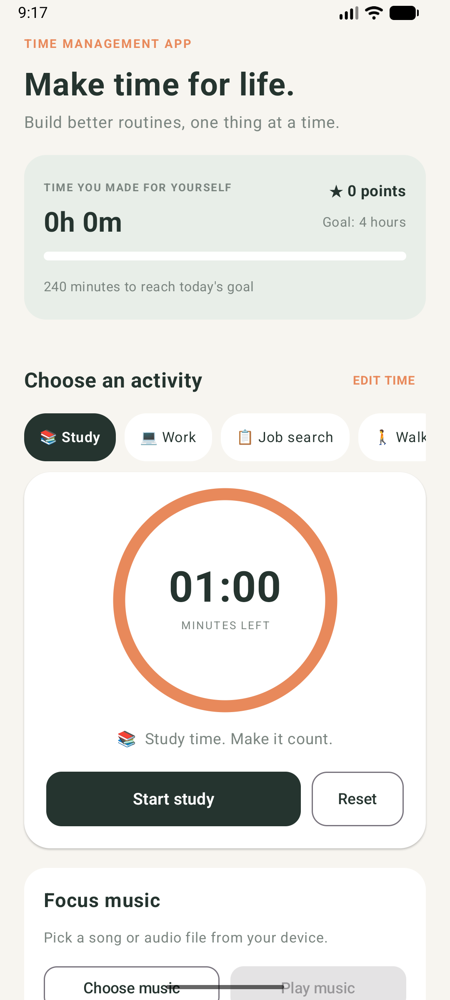
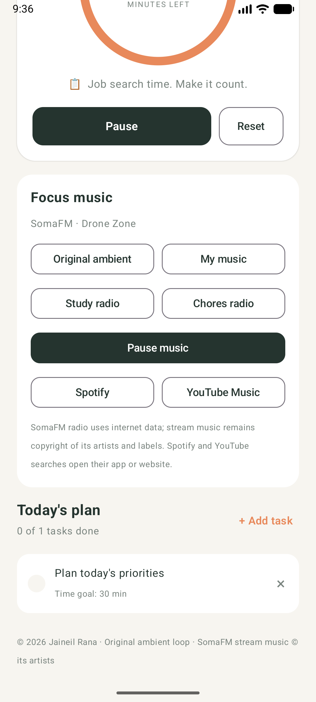

# Time Management App

**Make time for life.**

Time Management App is an Android app for people who want a little help making
time for the things that matter. Set a timer for studying, work, exercise,
walking, cooking, reading, hobbies, games, or your own custom activity. Keep a
short task list, track daily progress, and take breaks when you need them.

Made by **Jaineil Rana** · © 2026 Jaineil Rana

## Screenshots

| Focus timer and daily plan | Activity timer and music |
| --- | --- |
|  |  |

## What you can do

### Focus

- Start, pause, reset, and customize timers for a variety of activities.
- Begin with a 30-minute study session, or make your own activity and duration.
- Add daily tasks with time goals and earn points for completing sessions and
  tasks.
- See the minutes you have tracked toward the app's four-hour daily goal.
- Choose the original built-in ambient loop, music on your device, or SomaFM
  internet radio.
- Open activity-matched music searches in Spotify or YouTube Music.
- Celebrate a finished focus session with confetti, then choose a five-minute
  tap-the-star game or a five-minute break timer.

### Tools

- Check the date, time, and time zone set on your device.
- Use a stopwatch with start, pause, and reset controls.
- Set a one-time reminder alarm and stop it from the alarm screen or its
  notification.

## Run the app

### Android Studio

1. Clone or download this repository.
2. Open the project folder in Android Studio and allow Gradle to sync.
3. Choose an Android emulator or connect an Android phone.
4. Select the `app` run configuration and press **Run**.

### Build an APK on Windows

From the project folder in PowerShell:

```powershell
.\gradlew.bat assembleDebug
```

The installable debug APK is created at
`app/build/outputs/apk/debug/app-debug.apk`.

## Alarm and notifications

The alarm uses the alarm sound and alarm-volume setting configured on the
device. It keeps ringing until stopped. Allow notifications when Android asks;
you can also check the device's alarm volume and sound settings if you cannot
hear it. Android battery settings and device policies may delay alarms.

The clock uses the device's configured time zone; the app does not need your
location to display local time.

## Music and attribution

The bundled soft-focus ambient loop was made for this app and does not use
third-party music. SomaFM streams and broadcast tracks remain the property of
their respective artists and labels. Music picked from the device remains the
property of its copyright holder. Spotify and YouTube Music buttons open
activity-matched searches; they do not link accounts, control playback inside
the app, or copy and rehost songs. Internet radio uses mobile data when not on
Wi-Fi.

## Build a release bundle

To build an Android App Bundle:

```powershell
.\gradlew.bat bundleRelease
```

The bundle is written to `app/build/outputs/bundle/release/app-release.aab`.
Before publishing, set a globally unique application ID in
`app/build.gradle.kts`, create and protect your own Play upload key, and
configure `ANDROID_UPLOAD_STORE_FILE`, `ANDROID_UPLOAD_STORE_PASSWORD`,
`ANDROID_UPLOAD_KEY_ALIAS`, and `ANDROID_UPLOAD_KEY_PASSWORD` in your local
build environment. Do not commit your key or passwords. Without these values,
the generated release bundle is unsigned and cannot be uploaded to Google Play.
Follow the store's current testing and submission requirements.

## Project details

- **Platform:** Android
- **Language:** Kotlin
- **UI:** Jetpack Compose and Material 3
- **Minimum Android version:** Android 6.0 (API 23)
- **Application ID:** `com.timemanagementapp`

Source code: [jaineil32624/time-management-app on GitHub](https://github.com/jaineil32624/time-management-app).
